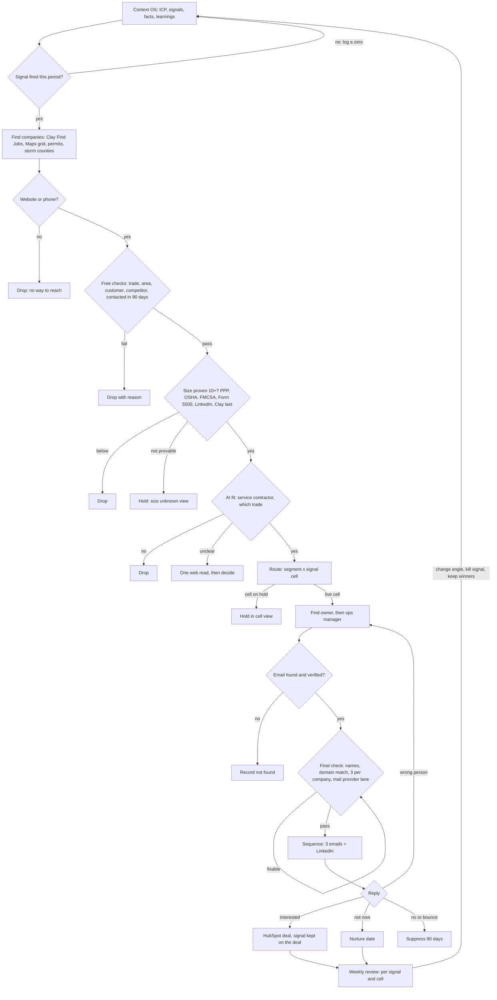

# GTM system - ServiceTitan outbound, end to end

*Designed before touching any tool (Week 1, step 8). It reads its thresholds from `context/icp/icp.md` and its signals
from `context/icp/signal-matrix.md`, so changing the ICP changes the system without rewriting it. Model: the class's
Reliance HMO system (slide 11); checked against the four pillars at the end. Tools named are the ones this repo uses;
nothing here sends email.*

**The thesis.** Selling software to trade contractors is a data problem before it is a copy problem. Most contractors
are invisible to B2B databases, and the ones that look small often aren't (field crews don't use LinkedIn). So the
system spends its effort on two things: catching a dated, physical reason to call (a storm, a permit, a licence, a
hiring push) and proving the company is big enough, from public files, before paying for any contact.
(Source: `context/docs/research/practitioner.md`.)

## The flow

```
Context OS -> signal fires -> find companies -> free checks -> size proof -> ICP fit -> route by segment
   -> find people -> find + verify email -> final check -> sequence (email + LinkedIn) -> replies -> CRM
   -> weekly review -> back into the Context OS
```

## Diagram (GitHub draws this from the code below)



## Step by step

| # | Step | What happens | Tool | Decisions (each answer and what it leads to) |
|---|---|---|---|---|
| 1 | **Context OS** | ICP, personas, signals, facts and the latest learnings are read before any run | This repo, Claude Code | Is the ICP or signal list older than 30 days? Yes: re-run the weekly review (step 13) first. No: go on |
| 2 | **Signal fires** | Each always-on signal from `signal-matrix.md` runs on its own cadence: office-staff and technician hiring weekly (G1, G2), storm reports daily with a weekly send (G3), permits weekly (G6), new locations and ownership changes monthly (G5, G7) | Clay Find Jobs, SPC storm reports and NWS API, city permit portals, Google Business Profiles, trade press | Did the signal produce new companies this period? Yes: step 3. No: log a zero (a real result) and wait for the next run |
| 3 | **Find companies** | Turn the signal into a company list: firms with the open roles, the contractor named on the permit, roofers in the storm counties (Maps grid, plus state licence files for names and phones) | Clay search (free), Google Maps grid (free), permit and licence files | Does the record have a website or phone? Yes: step 4. No: one free lookup (Maps by name + city); still nothing: drop, reason "no way to reach" |
| 4 | **Free checks** | Remove what can never buy: wrong trade, out of area, franchise head offices vs locations, existing customers, competitors, already contacted in 90 days | Clay formulas and lookups (free), exclusions table | Passes every free check? Yes: step 5. No: drop with the reason written on the row |
| 5 | **Size proof** | Prove 10 or more employees (the size line in `icp.md`) from the cheapest exact source first | PPP loan jobs, OSHA, FMCSA, Form 5500 (bulk, free) -> LinkedIn page count (free) -> Clay company enrichment (paid, last) | Proven at or above the line? Yes: step 6. Proven below: drop. Not provable: hold in a "size unknown" view, never mailed as a fit |
| 6 | **ICP fit** | One AI judgement a formula can't make: is this a residential or commercial service business (not a builder, supplier or franchisor), and which trades | Clay Use AI column, JSON out with an evidence field, run only on proven-size rows | Fit = yes: step 7. No: drop. Unclear: one Claygent web read, then decide or hold |
| 7 | **Route by segment** | Put each company in one routing cell: segment (S1 to S4 in `icp.md`) x the signal that fired, plus any secondary signal (G4 switches the angle to displacement) | Clay formula | Cell is live? Yes: step 8. Cell on hold (no proof point or copy yet): keep in its view, no contact |
| 8 | **Find people** | Owner or general manager first; operations or service manager second; never technicians or office staff | Clay Find People (free search), the company site's team page | Owner found? Yes: step 9. No: operations manager. Neither: generic inbox only if the company is proven 10+ |
| 9 | **Find and verify email** | Use emails a vendor already found; never build emails from a pattern (measured: about 15% pass vs 75%) | Clay email waterfall, then a verifier | Valid? Yes: step 10. Catch-all: second verifier. Invalid or not found: record "not found", no send |
| 10 | **Final check** | Last gate before anything is loaded: first name is a real first name, company name short and clean, email domain matches the company, 3 contacts max per company, mail provider split (Google / Microsoft / security gateway) | Pre-send checks in Clay or a script | Every check passes? Yes: step 11. Fixable (a name, a company name): fix and re-check. Not fixable: hold with the reason |
| 11 | **Sequence** | 3 emails over 10 days, one thread, plus 1 LinkedIn touch for owners with a profile. Copy uses only `context/messaging/facts.md` and the spec's variables | Sequencer (Smartlead or Clay Sequencer), LinkedIn | Security-gateway lane? Yes: send from the oldest inboxes only, smaller volume. No: normal lane |
| 12 | **Replies** | Every reply sorted: interested, not now, wrong person, not interested, out of office, bounce | Sequencer labels, n8n (week 4) | Interested: create a deal and alert the owner of the account. Wrong person: ask for the right one, add them. Not now: nurture date. Not interested or bounce: suppress the address and company for 90 days |
| 13 | **CRM** | Contacts, companies and deals with the signal and cell that produced them | HubSpot (week 3) | Deal stage moves? The source signal stays on the deal, so revenue is traced back to the signal |
| 14 | **Weekly review (feedback loop)** | Per signal and per cell: companies found, passed each step, cost per step, replies, positive replies, meetings, deals | Work log, HubSpot report | Cell below 1% positive replies after 500 contacted: change the angle or pause the cell. Signal yields no proven-size companies for 3 runs: kill it and write why in `knowledge-base/learnings/`. Winning angle: copy it to `context/messaging/messaging.md`. Every change is written back into the Context OS |

## Check against the four pillars (class, slide 10)

| Pillar | How the system meets it |
|---|---|
| **Clean data** | Free checks and size proof run before any paid step; every dropped row keeps its reason; emails are found, never guessed; the final check gates the send |
| **Always-on signals** | Storms, permits, licences and hiring run on fixed cadences, each with a dated reason to reach out |
| **Composable workflows** | One find-check-size-fit-route chain is reused by every signal; only the signal source and the angle change per cell |
| **Tight feedback loops** | The weekly review changes cells, signals and messaging in this repo, and the CRM keeps the source signal on every deal |

## Costs, in order (cheapest first)

Free: searches, Maps grid, public files, formulas, lookups, LinkedIn page counts. Paid, only on rows that passed
everything before: company enrichment (last resort for size), the AI fit column, email waterfall, verification.
Cost per step is written into the work log after every run.
