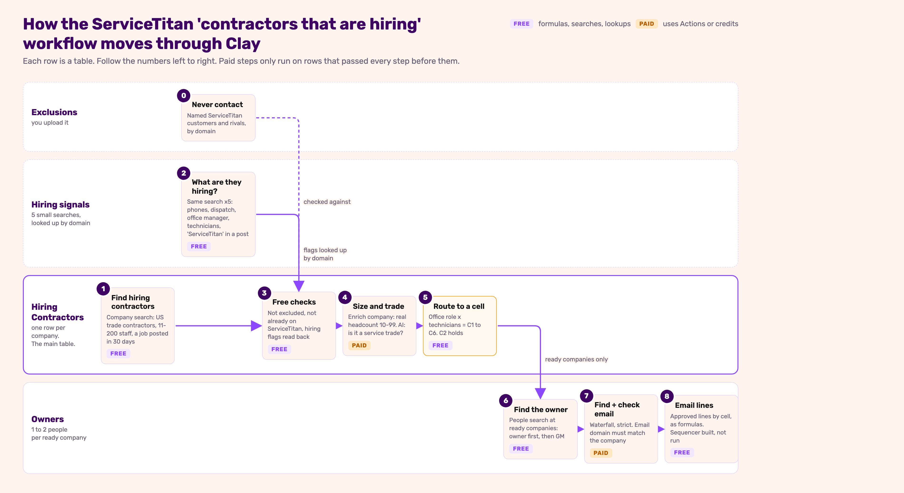

# Clay Build Guide: Contractors That Are Hiring (ServiceTitan)

A step-by-step guide to building `../workflow-spec.md` in Clay. Written for someone who has never built anything in
Clay. Follow the parts in order. Each step tells you **why** it exists, **what to click**, **what to type**, **how to
check it worked** and **what it costs**. Test size: **25 rows** for every paid step.

> **Don't skip the checks.** The most common Clay mistake is running a column on 500 rows before checking it worked on
> 1. Every step ends with a check. If it fails, fix it before moving on.

---

## Contents

- [What you are building](#what-you-are-building)
- [Clay words you need](#clay-words-you-need)
- [Before you start](#before-you-start)
- [Part 0. Set up the workbook](#part-0-set-up-the-workbook)
- [Part 1. Exclusions table](#part-1-exclusions-table)
- [Part 2. Find contractors that are hiring](#part-2-find-contractors-that-are-hiring)
- [Part 3. Hiring signal searches](#part-3-hiring-signal-searches)
- [Part 4. Free checks on each company](#part-4-free-checks-on-each-company)
- [Part 5. Size and trade checks (paid)](#part-5-size-and-trade-checks)
- [Part 6. Route each company to a cell](#part-6-route-each-company-to-a-cell)
- [Part 7. Find the owner](#part-7-find-the-owner)
- [Part 8. Find and verify the work email](#part-8-find-and-verify-the-work-email)
- [Part 9. Write the email lines](#part-9-write-the-email-lines)
- [Part 10. Views and tidy up](#part-10-views-and-tidy-up)
- [What it costs](#what-it-costs)
- [Final checklist](#final-checklist)
- [When something goes wrong](#when-something-goes-wrong)
- [Things the spec needs to fix](#things-the-spec-needs-to-fix)

---

## What you are building

The spec says: find **US trade contractors with 11 to 200 staff that posted a job in the last 30 days**, find out
**what they are hiring** (phones, dispatch, office manager, technicians, or something else), keep only real HVAC,
plumbing, electrical and garage door service companies with **10 to 99 employees**, put each one in one of **6 cells**,
then find the owner, verify their email and write the matching lines.

You will build **3 tables plus 5 small search tables** inside **1 workbook**:



Each row of the picture is a table. The numbers are the order you build in.

Why this shape:
- **Company first.** The trigger (a job post) happens to a company, not a person, so the main table is one row per
  company. People come last, and only at companies that passed every check.
- **Signals as separate searches.** Clay's company search can filter on job posts but doesn't return the post's title.
  So each kind of hire (phones, dispatch, office manager, technicians) gets its own small search, and the main table
  looks each one up by domain. Free.
- **Paid steps last.** Size and trade checks run only on companies that passed the free checks. Emails are found only
  for owners at companies that are ready.

What a finished row in **Hiring Contractors** looks like, reading left to right (made-up example):

| Company | Domain | Size band | Hiring office? | Office role | Hiring techs? | Employees | Trade | Fit? | Cell | Ready? |
|---|---|---|---|---|---|---|---|---|---|---|
| Example Heating & Air | exampleheating.com | 51-200 | true | phones | true | 64 | HVAC | true | C5 | true |

---

## Clay words you need

| Word | What it means |
|---|---|
| **Workbook** | A folder that holds several tables for one build |
| **Table** | A spreadsheet in Clay. Each row is a company or a person |
| **Source** | Where a table's rows come from: a search, a CSV, or another table |
| **Find companies / Find people** | Clay's own search of its company and people data. Searching and importing are free |
| **Column** | Plain (you type), **formula** (calculated, free) or **enrichment** (calls a data provider or AI, usually paid) |
| **Lookup** | A free column that finds a matching row in another table, here always by domain |
| **Send table data** | Copies rows from one table into another table. Free |
| **Run condition** | A rule that decides which rows a paid column runs on. Every paid column has one |
| **Auto-run** | When on, new rows run every column by themselves. Keep it **off** on every table |
| **Actions** | Clay's unit for running steps. Your Treford workspace has 50,000 |
| **Data Credits** | Paid data from providers (an email, a headcount). Your workspace has about 30,000 |
| **View** | A saved filter of a table ("Ready to send", "Held", "Dropped") |
| **Use AI** | A column that asks an AI model a question about each row, using data already in the row |

---

## Before you start

- [ ] Logged in to Clay in **Johnson's Workspace** (top left). Not a work workspace.
- [ ] Credits showing under Settings > Plans & Billing (about 30,000 credits, 50,000 actions on 24 Nov 2026).
- [ ] The spec open: `../workflow-spec.md` (sections 1 to 6).
- [ ] `exclusions.csv` ready (Part 1).
- [ ] Write the Actions and Data Credits counters down now. You'll write them again after each paid step.

---

## Part 0. Set up the workbook

**Why:** one workbook per build keeps every stage visible (the class rule: one table per stage).

1. Home > **+ New** > **Workbook**.
2. Name it `ServiceTitan | Contractors Hiring | 24 Nov 2026`.
3. Description: `Trigger: US trade contractor posted a job in 30 days. Spec: github.com/johnson-taiwo/servicetitan-gtm-os/blob/main/output/campaigns/office-under-pressure/workflow-spec.md`

**Check:** the workbook opens empty with that name.
**Cost:** free.

---

## Part 1. Exclusions table

**Why:** spec section 2 "Exclude". Companies we must never contact, matched on domain.

### 1.1 Build the CSV

Columns: `Company Name | Domain | Type`. Domains are written plain (`acme.com`). Leave a domain blank rather than guess
it, then fill it in from the company's website.

| Company Name | Domain | Type |
|---|---|---|
| ServiceTitan | servicetitan.com | Vendor |
| Housecall Pro | housecallpro.com | Competitor |
| Jobber | getjobber.com | Competitor |
| FieldEdge | fieldedge.com | Competitor |
| Service Fusion | servicefusion.com | Competitor |
| Successware | successware.com | Competitor |
| BuildOps | buildops.com | Competitor |
| ServiceTrade | servicetrade.com | Competitor |
| Workiz | workiz.com | Competitor |
| AccuLynx | acculynx.com | Competitor |
| JobNimbus | jobnimbus.com | Competitor |
| FieldPulse | fieldpulse.com | Competitor |
| Commusoft | commusoft.com | Competitor |
| Zuper | zuper.co | Competitor |
| Young Plumbing Services | | Customer (named in a case study) |
| Brothers Plumbing, Heating & Electric | | Customer |
| Redding Heating & Air | | Customer |
| Esser Air | | Customer |
| Interstate AC | | Customer |
| Crown Heating, Cooling and Plumbing | | Customer |
| Village Plumbing & Air | | Customer |
| Lee's Air, Plumbing & Heating | | Customer |
| Adams Power | | Customer |
| Jackson Services | | Customer |
| Vines Restoration, Plumbing and HVAC | | Customer |
| Best Quality Electric | | Customer |
| Del-Air | | Customer |
| Goettl Air Conditioning & Plumbing | | Customer |
| Yarbrough & Sons | | Customer |

(Customer names come from `context/docs/research/customers.md`. The full list of 30 is there; these are the HVAC,
plumbing and electrical ones this workflow could meet.)

### 1.2 Upload it

1. In the workbook: **+ Add table** > **Import CSV** > `exclusions.csv`. Name it `Exclusions`.
2. Set the `Domain` column type to **URL**.

**Check:** 29 rows, 3 columns. Every filled domain has no `https://`, `www.` or `/`.
**Cost:** free.

---

## Part 2. Find contractors that are hiring

**Why:** this is the trigger (spec section 1). Searching and importing are free.

### 2.1 Start the search

1. **+ Add table** > **Find companies**.
2. Set these filters (spec section 2, ICP box):

| Filter | Set it to | Why |
|---|---|---|
| **Industry** | Specialty Trade Contractors · Building Equipment Contractors | The trades. The official trade code (238220 / 238210) returned only 1 company with a job post, too narrow |
| **Company size** | 11-50 · 51-200 | Clay's band for "about 10 to 200". The real 10 to 99 check comes in Part 5 |
| **Location** (headquarters) | United States | US only |
| **Job postings** (may be called "Hiring" or "Has job postings") | Posted in the last **30 days** | The trigger |

> If the job filter isn't in the panel, the same search can be run from Claude Code with Clay's CLI, using the query in
> `../workflow-spec.md` section 2. It's the exact search tested on 24 Nov.

### 2.2 Check the number before importing

**Count on 24 Nov 2026: 58 companies.** Write today's count here: ___. If it's under 25, widen the post date to 60
days and write that count too.

### 2.3 Import

1. Import all rows. Name the table `Hiring Contractors`.
2. **Turn auto-run off now:** table settings > **Auto-run** > off.
3. Open one cell of the search result and **Add as column**: `Domain`, `Size`, `Industry`, `Location`, `Description`,
   `LinkedIn URL`. Set `Domain` and `LinkedIn URL` to **URL** type.
4. Remove duplicates on `Domain`.

**Check:** about 58 rows, one per domain, every row has a domain.
**Cost:** free.

---

## Part 3. Hiring signal searches

**Why:** spec section 4, signals 2 to 5. Each search answers one yes/no question about every company.

Make 5 more **Find companies** tables with the **same three base filters** as Part 2 (industry, size, US), each with a
different job filter. Import each, turn auto-run off, add `Domain` as a column.

| Table name | Job filter (posted in the last 30 days, title like…) | Answers |
|---|---|---|
| `Sig - Phones` | Customer Service Representative · Call Center · Customer Care | `role_family` = phones |
| `Sig - Dispatch` | Dispatcher · Scheduler · Service Coordinator | `role_family` = dispatch |
| `Sig - Office Manager` | Office Manager · Office Administrator | `role_family` = office |
| `Sig - Technicians` | HVAC Technician · Plumber · Electrician · Service Technician · Installer | `hiring_techs` |
| `Sig - ServiceTitan users` | Job description contains `ServiceTitan` (any title) | likely customer, exclude |

**Check:** write each table's row count. Most will be small (single digits). A count of 0 is a valid answer.
**Cost:** free.

---

## Part 4. Free checks on each company

**Why:** spec section 2 Exclude and section 4. Everything here is free.

In `Hiring Contractors`, add one **Lookup** column per table, matched on `Domain` (Lookup > Single row > table > match
`Domain` = `Domain`). Then add these formula columns:

| Column | Plain English | Formula |
|---|---|---|
| `Excluded?` | True if the domain is in the Exclusions table | `!!{{Exclusions Lookup}}` |
| `On ServiceTitan?` | True if any post asked for ServiceTitan experience | `!!{{ServiceTitan Users Lookup}}` |
| `Phones?` | Found in the phones search | `!!{{Phones Lookup}}` |
| `Dispatch?` | Found in the dispatch search | `!!{{Dispatch Lookup}}` |
| `Office Mgr?` | Found in the office manager search | `!!{{Office Manager Lookup}}` |
| `Hiring Office?` | Any of the three office searches matched | `{{Phones?}} \|\| {{Dispatch?}} \|\| {{Office Mgr?}}` |
| `Hiring Techs?` | Found in the technicians search | `!!{{Technicians Lookup}}` |
| `Role Family` | Dispatch wins, then phones, then office manager, else blank | `{{Dispatch?}} ? "dispatch" : {{Phones?}} ? "phones" : {{Office Mgr?}} ? "office" : ""` |
| `Role Posted` | The role in plain words, for copy | `({{Role Family}} === "dispatch") ? "dispatcher" : ({{Role Family}} === "phones") ? "customer service rep" : ({{Role Family}} === "office") ? "office manager" : ""` |
| `Free Pass?` | Not excluded and not already on ServiceTitan | `!{{Excluded?}} && !{{On ServiceTitan?}}` |

If `!!{{X Lookup}}` returns true on every row, the lookup holds an empty object when nothing matched: use
`!!({{X Lookup}} && {{X Lookup}}.Domain)` instead (open a cell to see the field name).

**Check:** filter `Excluded?` is checked: only rows whose domain is in Exclusions. Spot-check 3 rows of `Role Family`
against the signal tables by hand.
**Cost:** free.

---

## Part 5. Size and trade checks

**Why:** spec section 2 Size gate and the trade fit. These are the first paid steps, so they run only on `Free Pass?`
rows, 1 row first.

### 5.1 Enrich company (headcount, description)

1. **+ Add column** > **Enrich company** (Clay's company enrichment), input `Domain`.
2. **Run condition:** `{{Free Pass?}}`
3. Run on **1 row**. Open the cell: find the employee count and the description. **Add as column**: `Employee Count`,
   `Enriched Description`, `Website`.
4. Then run on the rest.

| Column | Plain English | Formula |
|---|---|---|
| `Size OK?` | Employee count between 10 and 99 | `Number({{Employee Count}} \|\| 0) >= 10 && Number({{Employee Count}} \|\| 0) <= 99` |

**Check:** compare `Employee Count` with `Size`. On 24 Nov, Clay's band and its own count disagreed on 6 of 42
companies, so expect a few mismatches. Trust the count.
**Cost:** about 1 Action per row (watch the counter).

### 5.2 Use AI: is it a service trade?

1. **+ Add column** > **Use AI**. Model: the cheapest model your workspace offers that returns JSON.
2. Prompt:
   > *You are checking whether a company is a residential or commercial service contractor. Company: {{Name}}. Website:
   > {{Website}}. Industry: {{Industry}}. Description: {{Enriched Description}} {{Description}}. Answer only from this
   > text. A service contractor installs, repairs and maintains systems at customers' homes or buildings (HVAC,
   > plumbing, electrical, garage doors). Builders, developers, suppliers, manufacturers, staffing agencies and
   > franchise head offices are not service contractors. Return JSON.*
3. Output format **JSON**, exactly these fields:
   - `service_contractor`: one of `yes`, `no`, `unclear`
   - `trade`: one of `hvac`, `plumbing`, `electrical`, `garage door`, `multi-trade`, `other`
   - `franchisor`: one of `yes`, `no`, `unclear`
   - `evidence`: the words from the text that decided it
4. **Run condition:** `{{Free Pass?}} && {{Size OK?}}`
5. Run on **3 rows you can judge yourself** (one HVAC, one that looks like a builder, one unclear). If any answer is
   wrong, fix the prompt and re-run the same 3 rows. Then run the rest.

| Column | Plain English | Formula |
|---|---|---|
| `Trade` | The AI's trade answer | `({{AI Fit}} && {{AI Fit}}.trade) \|\| ""` |
| `Fit?` | A service contractor in our trades, not a franchisor. "unclear" counts as not a fit until checked | `!!{{AI Fit}} && {{AI Fit}}.service_contractor === "yes" && {{Trade}} !== "other" && {{AI Fit}}.franchisor !== "yes"` |

**Check:** read the `evidence` on 5 random rows. Each should quote real words from the description.
**Cost:** about 1 Action per row plus the AI model's cost (shown on the column).

---

## Part 6. Route each company to a cell

**Why:** spec section 5. The routing matrix becomes two formulas.

#### `Cell`: which routing cell (routes on Hiring Office?, Role Family, Hiring Techs?)

- **Plain English:** *"C5 if hiring office and technicians. C4 if only technicians. If only office: C1 for phones, C2
  for dispatch, C3 for office manager. C6 if hiring something else."*
- **Formula:**
```javascript
{{Hiring Office?}} && {{Hiring Techs?}} ? "C5"
: {{Hiring Techs?}} ? "C4"
: {{Role Family}} === "phones" ? "C1"
: {{Role Family}} === "dispatch" ? "C2"
: {{Role Family}} === "office" ? "C3"
: "C6"
```

#### `Ready to Contact?`: passed everything and the cell can send

- **Plain English:** *"True when the company passed the free checks, the size check and the trade fit, and its cell is
  not C2 (C2 waits for a dispatch proof point)."*
- **Formula:** `{{Free Pass?}} && {{Size OK?}} && {{Fit?}} && {{Cell}} !== "C2"`

**Check:** filter `Ready to Contact?` is checked and open every row. Would you be happy for each to get the email?
C2 rows stay in the table, unchecked.
**Cost:** free.

---

## Part 7. Find the owner

**Why:** spec section 2 Recipient. People are searched only at ready companies.

1. In `Hiring Contractors`, make a view `Ready companies` (filter `Ready to Contact?` is checked).
2. **+ Add table** > **Find people**, starting **from a table**: pick `Hiring Contractors`, view `Ready companies`.
   Never paste domains: a pasted list is a snapshot.
3. Filters: **Job title** Owner · President · CEO · Founder · Co-Owner · General Manager · Operations Manager.
   **Limit** 2 per company.
4. Check the count of companies found against the view's row count. Write both.
5. Import. Name it `Owners`. **Auto-run off.** Add as columns: `First Name`, `Last Name`, `Title`, `Company Domain`,
   `LinkedIn Profile`. Dedupe on `LinkedIn Profile`.
6. Lookup `Hiring Contractors` on `Company Domain` to bring back `Cell`, `Role Posted`, `Trade`, `Ready to Contact?`,
   `Name`, and the HQ city.

| Column | Plain English | Formula |
|---|---|---|
| `Owner First?` | Owner-type titles first, GM second | `/owner\|president\|ceo\|founder/i.test({{Title}} \|\| "") ? 1 : 2` |
| `Company Ready?` | The company row is ready | `!!({{Company Lookup}} && {{Company Lookup}}["Ready to Contact?"])` |

**Check:** no person at a company that isn't ready. Titles look like owners or managers, not technicians.
**Cost:** free.

---

## Part 8. Find and verify the work email

**Why:** usually the most expensive step, so it runs last and only on ready rows.

1. **+ Add column** > **Find work email** (waterfall). About 4 providers, **validation on, strict**: no catch-all, no
   risky.
2. **Run condition:** `{{Company Ready?}}`
3. Run on **1 row**, read the cell (provider used, verdict). Then the rest.

| Column | Plain English | Formula |
|---|---|---|
| `Email Domain` | Everything after the @ | `(({{Work Email}} \|\| "").split("@")[1] \|\| "").toLowerCase()` |
| `Email Matches Company?` | The email is at the company's own domain | `{{Email Domain}} !== "" && {{Email Domain}} === ({{Company Domain}} \|\| "").toLowerCase()` |
| `Send Ready?` | Ready company, verified email on the right domain | `{{Company Ready?}} && {{Email Matches Company?}}` |

**Check:** every `Send Ready?` row has an email at the company domain. Write the fill rate: emails found / owners.
**Cost:** Actions plus Data Credits for each provider step that runs (shown per cell).

---

## Part 9. Write the email lines

**Why:** spec "Copy". Approved lines become formulas, word for word, picked by cell. Each starts blank unless the row
is ready. Spintax stays in the sequencer.

#### `E1 L1` (routes on Cell)
```javascript
!{{Send Ready?}} ? "" :
{{Cell}} === "C1" ? "The " + {{Role Posted}} + " opening at " + {{Company Short}} + " usually means call volume has grown past the people answering it." :
{{Cell}} === "C2" ? "Bringing on a " + {{Role Posted}} + " usually means scheduling at " + {{Company Short}} + " has become a full-time job." :
{{Cell}} === "C3" ? "The " + {{Role Posted}} + " opening at " + {{Company Short}} + " usually means the billing and paperwork now need someone full time." :
{{Cell}} === "C4" ? "Adding technicians at " + {{Company Short}} + " usually means more trucks to keep busy every morning." :
{{Cell}} === "C5" ? "Hiring for the office and the field at once usually means " + {{Company Short}} + " is growing on both sides." :
"A new opening at " + {{Company Short}} + " usually means the team is growing."
```

#### `E1 L2` (routes on Cell)
```javascript
!{{Send Ready?}} ? "" :
["C1","C2","C3"].includes({{Cell}}) ? "Could be off, but my read is the field team is holding steady while the office workload grows." :
{{Cell}} === "C4" ? "My guess is the office will feel every one of those new trucks." :
{{Cell}} === "C5" ? "With " + ({{Role Posted}} === "office manager" ? "an " : "a ") + {{Role Posted}} + " and technicians both open, my guess is the calls and the schedule are where it gets tight." :
"Could be off, but growth usually shows up first in the calls that need booking."
```

#### `Social Proof` (routes on Cell; C2 has no proof yet and is never ready)
```javascript
!{{Send Ready?}} ? "" :
{{Cell}} === "C1" ? "Brothers Plumbing cut their call abandon rate from near 30% to 5% on it." :
{{Cell}} === "C3" ? "Adams Power now gets service invoices out in a week and a half to two weeks, versus up to four before." :
{{Cell}} === "C4" ? "Young Plumbing went from 4 to 8 trucks in a year on it." :
{{Cell}} === "C5" ? "Vines Restoration went from 400 to 500 abandoned calls a day to slim to none, with 70+ trucks on the road." :
"Redding Heating & Air saw their call booking rate rise 30% and their close rate 40% after turning on Max."
```

Helper columns first:

| Column | Plain English | Formula |
|---|---|---|
| `First Name Clean` | First name, first letter capital, rest lower | `({{First Name}} \|\| "").trim().charAt(0).toUpperCase() + ({{First Name}} \|\| "").trim().slice(1).toLowerCase()` |
| `Company Short` | Company name without Inc, LLC, Co | `({{Name}} \|\| "").replace(/,?\s+(inc\|llc\|co\|corp\|corporation\|company\|ltd)\.?$/i, "").trim()` |

**Check:** read two finished emails out loud, one from C1 and one from C4. They should match the spec word for word.
**Cost:** free.

**As built (25 Nov 2026), three changes from the formulas above:**
1. True/false formula columns come back from Clay as the TEXT "true" / "false", so `!{{Send Ready?}}` is never true.
   Every gate is written `!(({{Send Ready?}} + "") === "true") ? "" : ...` and every cell test `({{Cell}} + "") === "C4"`.
2. `Company Short` also cuts anything after " | " (one company name came as "Bud Anderson | Cooling, Heating, ...").
   It reads `{{Company}}` in the Owners table, not `{{Name}}`.
3. Added `E2 Proof` (spec Email 2: C6 gets the Young Plumbing revenue line, every other cell the Redding line).
Read back on all 28 owners: the 15 send-ready rows have all four lines, the 13 others are blank. No C1 or C3 rows
exist in this build, so those branches are written but untested on live data.

---

## Part 10. Views and tidy up

**Why:** someone opening the table next month should follow it left to right without asking.

1. Every formula column: paste its **Plain English** text as the column description.
2. Group and colour the columns in build order: **Company** · **Signals** · **Free checks** · **Company checks** ·
   **Routing** (and in `Owners`: **Person** · **Email** · **Copy**).
3. Views in `Hiring Contractors`: **Ready to send** (`Ready to Contact?` checked) · **Held** (`Free Pass?` and
   `Size OK?` checked, `Ready to Contact?` unchecked: C2 and unclear fits) · **Dropped** (`Free Pass?` or `Size OK?`
   unchecked). Views in `Owners`: **Send ready** (`Send Ready?` checked).
4. Don't hide enrichment, lookup or Send table data columns in the main view.

**Check:** a classmate can say why any row was dropped by reading its row.
**Cost:** free.

---

## What it costs

| Paid step | Runs on | Rough cost |
|---|---|---|
| Enrich company | `Free Pass?` rows (at most 58) | about 1 Action per row |
| Use AI: service trade | `Free Pass?` and `Size OK?` rows | about 1 Action per row plus the model's cost |
| Find work email (waterfall) | Owners at ready companies (about 2 per company) | Actions plus Data Credits per provider step that runs |

Free: all searches and imports, formulas, lookups, views.

**Worked example for the 25-row test:** about 25 Actions for Enrich company, about 20 Actions plus a few cents of AI for
the fit column, and Actions plus Data Credits for about 30 owner lookups in the waterfall. Write the counters before
and after each step in the work log: faculty ask for cost per row.

---

## Final checklist

- [ ] Auto-run off on every table
- [ ] Every paid column has a run condition and was proven on 1 row (AI on 3)
- [ ] Every lookup matches on domain
- [ ] Exclusions respected: no excluded or ServiceTitan-user company is ready
- [ ] C2 rows stay in the table with `Ready to Contact?` unchecked
- [ ] At least 20 companies with the signal, the AI column and an email (or a recorded "not found")
- [ ] Two sample emails read out loud
- [ ] Every formula has a description; columns grouped; Ready / Held / Dropped views exist
- [ ] Credits written down before and after every paid step

---

## When something goes wrong

| What you see | Likely cause | Fix |
|---|---|---|
| The search shows a handful of companies | Clay's job data is thin for trades (58 of 3,221 on 24 Nov) | Widen the post date to 60 days, or add "Building Construction" to industry, and write both counts |
| A lookup column is true on every row | The lookup returns an empty object | Use `!!({{X Lookup}} && {{X Lookup}}.Domain)` |
| Credits dropped on rows you didn't expect | Auto-run was on, or a run condition is missing | Turn auto-run off; add the run condition; spent credits don't come back |
| `Employee Count` empty | Enrich company found no count | `Size OK?` is false, so the row is held, not dropped. Check by hand only if you need the row |
| AI says `unclear` often | The description is short | Add the website text with a Claygent fallback (stretch), run only on `unclear` rows |
| An email at gmail.com or another company | Personal or old employer email | `Email Matches Company?` is false, so the row isn't send ready |

---

## Things the spec needs to fix

1. **Section 6, `role_posted`:** Clay's company search doesn't return the post's title, so `role_posted` comes from
   which office search matched ("customer service rep", "dispatcher", "office manager"), not the exact title. The
   variables contract should say so.
2. **Section 3, size gate:** the spec mentions public files (PPP, OSHA) for size proof. Inside Clay this build uses
   Enrich company's count. Public files stay the off-Clay route for scale.
3. **Copy, E1 L2 for C5:** "a {{role_posted}}" needs "an" for "office manager". The formula in Part 9 handles it; the
   spec line should show both.
